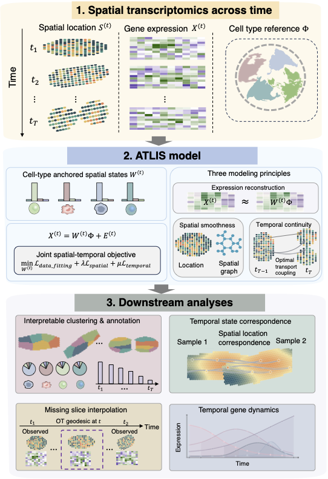

# ATLIS: Anchored Tissue Landscape in Interpretable Space

ATLIS is an interpretable spatial–temporal modeling framework in which cell-type composition defines an interpretable latent space that anchors spatial organization and temporal evolution in multi-slice spatial transcriptomics data.

Installation
------------
You can install the released version of ATLIS from Github with the following code:

`git clone https://github.com/YMa-lab/ATLIS.git`

Example notebooks
------------
[Synthetic example notebook](https://github.com/WenjunZHAOwO/ATLIS/blob/main/Scripts/Synthetic.ipynb)

[Mouse dorsal brain example notebook](https://github.com/WenjunZHAOwO/ATLIS/blob/main/Scripts/Mouse_dorsal_brain.ipynb)

[Zebrafish development example notebook](https://github.com/WenjunZHAOwO/ATLIS/blob/main/Scripts/Zesta_development.ipynb)

[Axolotl brain regeneration example notebook](https://github.com/WenjunZHAOwO/ATLIS/blob/main/Scripts/Axolotl_regeneration.ipynb)

[Mouse aging brain example notebook](https://github.com/WenjunZHAOwO/ATLIS/blob/main/Scripts/Mouse_aging.ipynb)

Data download instructions can be found within each real data notebook.

How to cite`ATLIS`
-------------------
Wenjun Zhao# and Ying Ma#, Cell-type-anchored latent modeling reconstructs spatial-temporal tissue dynamics. 2026

